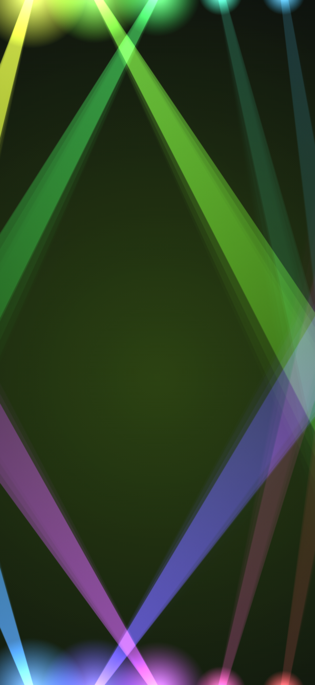
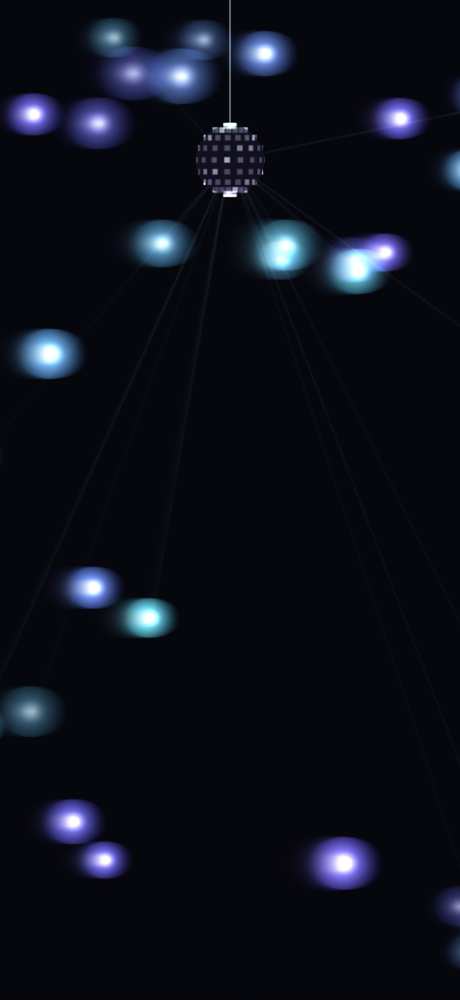
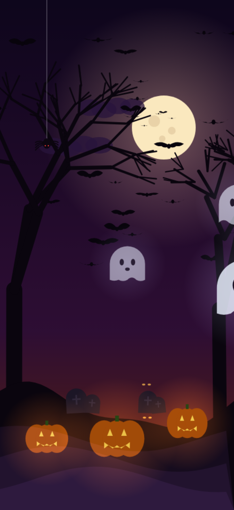
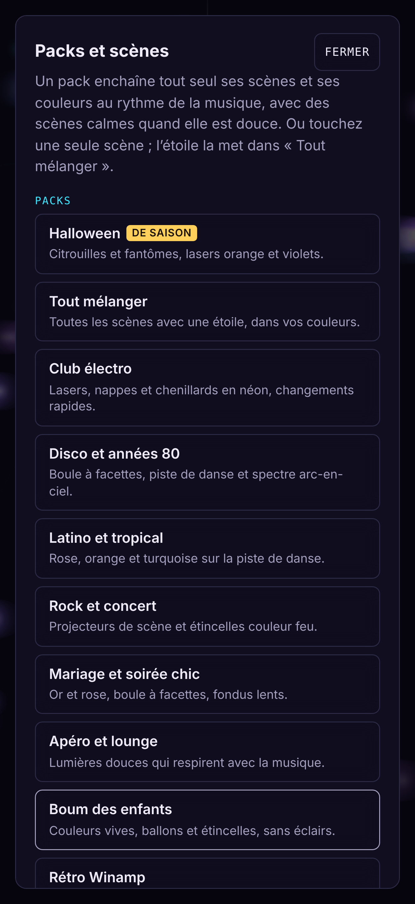
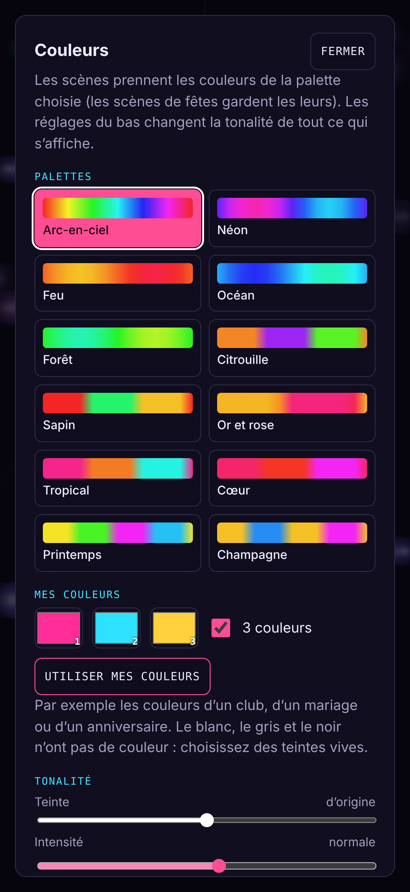

# Jeux de lumière

**Votre TV devient un jeu de lumière qui suit la musique.** Sans matériel à acheter : un téléphone, une TV (ou une tablette, un ordinateur), et la soirée commence.

**Essayer l’appli :** https://paulalainpichereau-create.github.io/jeux-de-lumiere/

## L’idée

Les jeux de lumière de soirée coûtent cher et prennent de la place. Presque tout le monde a déjà une TV et un téléphone : l’appli écoute la musique, repère les graves, les aigus et les battements, et projette sur l’écran des lumières qui bougent au rythme, comme un vrai jeu de lumière. Les téléphones des invités peuvent même devenir des lumières d’appoint dans la pièce.

## Ce qu’elle fait

**Des lumières qui suivent la musique**
- 26 scènes : projecteurs, lasers, boule à facettes, chenillard, nappe laser, piste de danse, tunnel, spectre, étincelles, aurore…
- Des effets façon Winamp et **MilkDrop** pour les nostalgiques
- **Dalle de couleur** : tout l’écran d’une seule couleur qui pulse, saute ou glisse au rythme
- 6 scènes de fête : Halloween, Noël, Nouvel An, Saint-Valentin, Pâques, Anniversaire
- **Mode Auto** : les scènes s’enchaînent toutes seules, avec des fondus, des scènes calmes quand la musique se calme, et un changement net au moment du « drop »

**Des soirées prêtes à l’emploi : 15 packs**
Club électro, Disco, Latino, Rock, Mariage, Lounge, Boum des enfants, Rétro… et un pack par fête. Chaque pack a ses scènes, ses couleurs et son rythme. Le pack de la saison est proposé en premier.

**Les couleurs**
12 palettes, vos propres couleurs (celles d’un club, d’un mariage…), et des réglages de teinte, d’intensité et de luminosité.

**Sur la TV, de plusieurs façons**
- Un **téléphone en télécommande** : il écoute la musique et pilote l’écran branché sur la TV (on scanne un QR code)
- **Plusieurs écrans** en même temps : la même scène partout, une couleur différente sur chaque écran, ou une scène différente par écran
- **Chromecast** et Google TV
- **App iPhone** : les lumières suivent Spotify ou Deezer **sans micro**, en captant le son joué par le téléphone

**Les invités participent**
- En scannant un QR code, leur **téléphone devient une lumière** : pulsation, vague, étincelles, arc-en-ciel, briquets pour les slows…
- Ils envoient des **messages et des émojis** qui s’affichent sur la TV (filtrés, sous le contrôle de l’hôte)

**Et aussi** : message ou compte à rebours à l’écran, stroboscope (désactivé par défaut), écran toujours allumé, fonctionne sans internet une fois ouvert, aucun compte, aucune publicité, aucune donnée collectée.

## Où elle tourne

| | État |
|---|---|
| **Site web** (tous appareils, installable sur l’écran d’accueil) | en ligne |
| **App Android** (téléphones, tablettes, Android TV) | prête, à publier sur Google Play |
| **App iPhone / iPad** (lumières + Spotify sans micro + Chromecast) | prête, à publier sur l’App Store |

## Pour les développeurs

Tout est expliqué dans **[DEVELOPPEURS.md](DEVELOPPEURS.md)** : architecture, protocole entre les appareils, lancer et tester en local, publier.
Le dossier pour les stores (textes, captures, guide) est dans [`stores/`](stores/).

---

Bibliothèques utilisées (toutes sous licence MIT) : [Butterchurn](https://github.com/jberg/butterchurn) (MilkDrop), [PeerJS](https://peerjs.com) (liaison entre appareils), [MQTT.js](https://github.com/mqttjs/MQTT.js) (relais), [qrcode-generator](https://github.com/kazuhikoarase/qrcode-generator). Confidentialité : [confidentialite.html](https://paulalainpichereau-create.github.io/jeux-de-lumiere/confidentialite.html).
